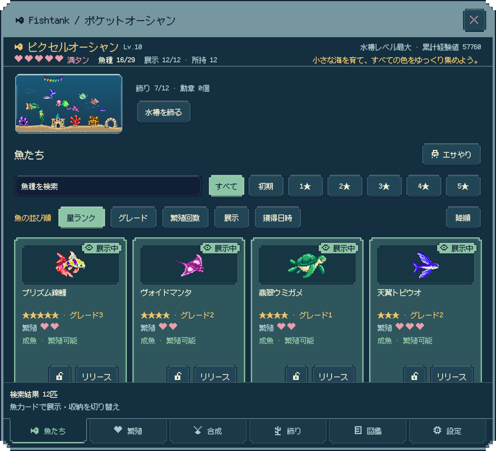
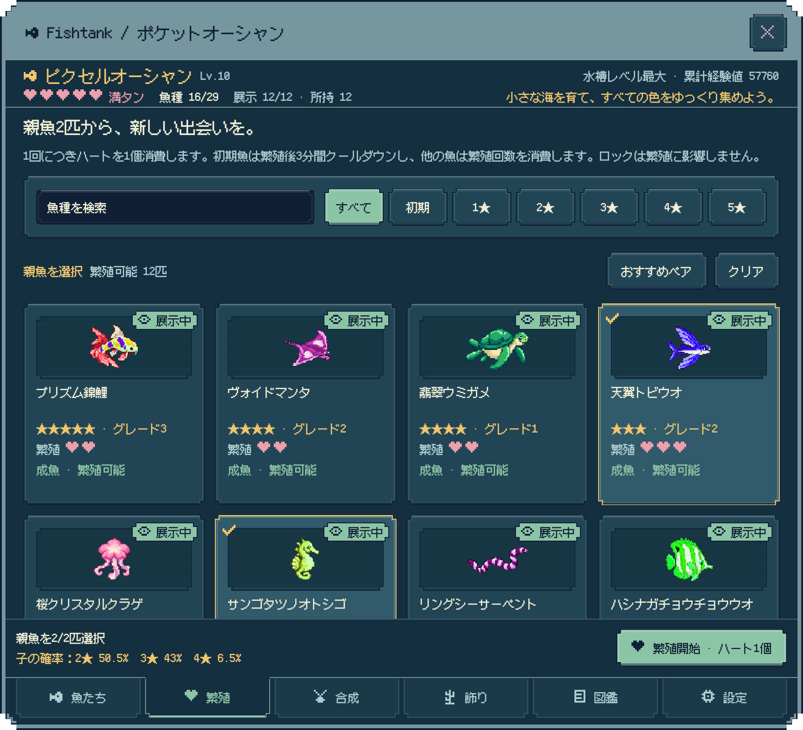
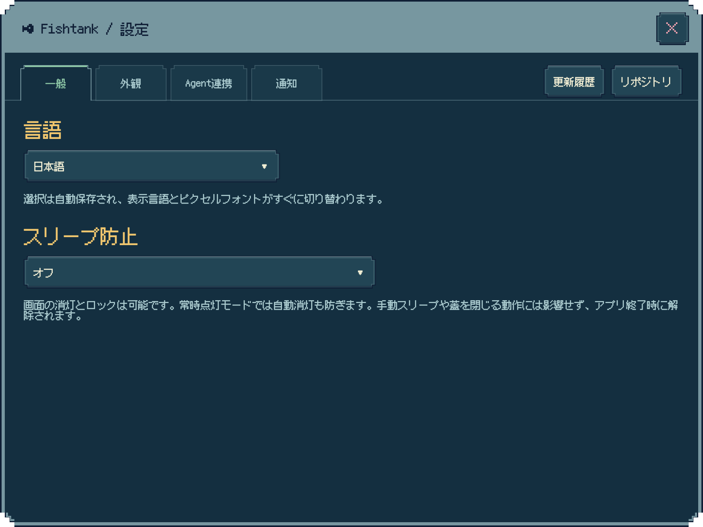
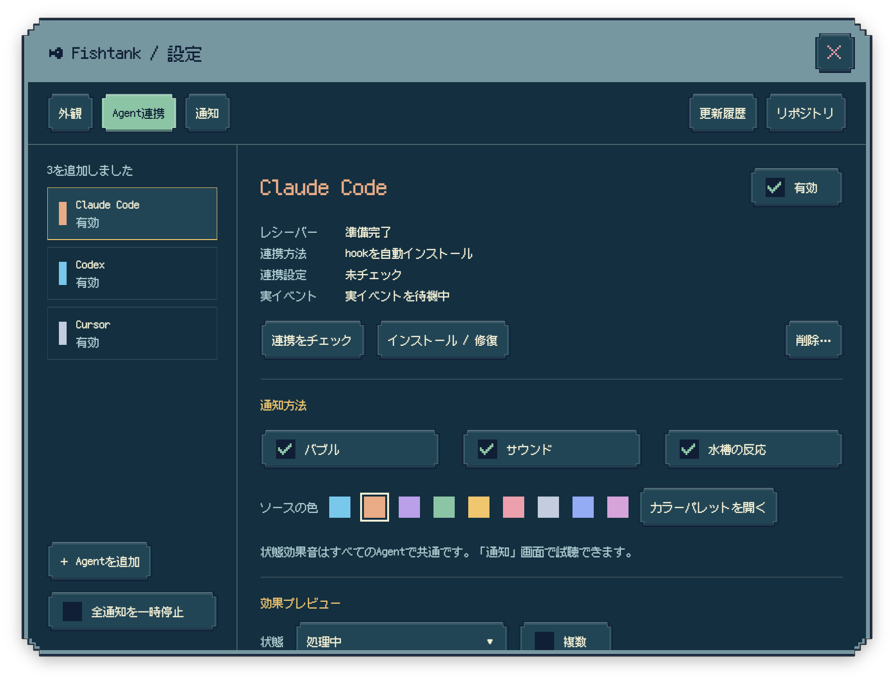
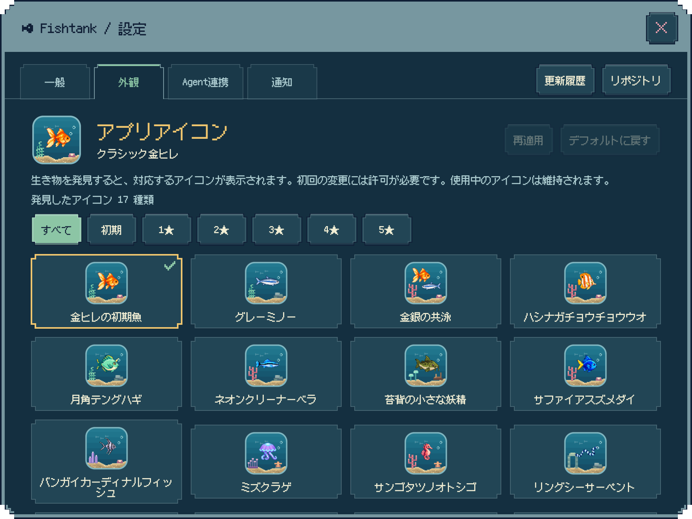

  <a href="README.md">English</a> · <a href="README.zh-Hans.md">简体中文</a> · <a href="README.zh-Hant.md">繁體中文</a> · <a href="README.ja.md">日本語</a>

  
  <h1>Fishtank</h1>
  
デスクトップに小さな海を。新しい魚と、ちょっといい知らせを待ちながら。

  
ピクセル水槽 · 繁殖とコレクション · Agent通知

  

    
    
    
  

Fishtankは、**MacとiPad**で楽しめるピクセルアートの育成水槽です。Macでは、デスクトップの片隅に小さな水槽が暮らします。魚がゆっくり泳ぎ、泡が静かに昇るなか、ひと粒の餌を落としても、仕事のお供にそっと眺めてもかまいません。

ソースコードは公開済みで、Mac版とiPad版の正式な配布方法は現在準備中です。

## 小さな魚から、ひとつの海へ

最初の小さな魚から星5のニシキゴイ、クラゲ、シードラゴン、コウイカまで、**通常の生き物30種類**を集めましょう。ペアを組むたびに、新しい色や姿、まだ見たことのない水中の仲間と出会えるかもしれません。

- 稚魚の成長を見守り、次のペアを選び、新しい発見を図鑑に加えられます。成長中、クールダウン中、繁殖できる状態も、ラベルでひと目でわかります。
- 合成でステップアップし、水槽を広げながら、残したい魚をロックできます。
- 実績メダルを集め、お気に入りの成果を水槽に飾れます。
- 進み具合は自動で保存されるので、少し離れて戻ったときにも成長の驚きが待っています。

育成ガイドで魚、繁殖、合成、飾り、図鑑、設定をまとめて管理できます。魚の一覧はページを切り替えずにスクロールでき、魚の数、選択数、確率、よく使う操作は下部のバーでいつでも確認できます。

次のペアに迷ったら「おすすめペア」を。まだ発見していない魚を優先し、その後は新しい姿を探せる組み合わせを選びます。ペアを選ぶと、下部のバーで子の星ランクごとの確率を確認してからハートを使えます。

繁殖回数を使い切った星5の生き物は、3匹を使う**星5リフォージ**で新しい仲間に生まれ変わります。ここでしか出会えない隠し生物は3種類。初めての発見と全種類の収集には専用メダルも。未発見の通常の生き物は図鑑にシルエットだけが現れ、名前はまだ秘密です。

## 眺めるだけではありません

**何もない場所をクリックすると餌やり**ができ、ポインターに合わせた位置から餌が落ちます。**ダブルクリックで育成ガイドを開く**ことができ、**右クリックで水槽を揺らす**と、小さな音とともに魚たちが驚き、3～5秒ほど素早く泳ぎます。魚を軽くタップすれば、種類ごとのちょっとした反応も楽しめます。

泳ぎ方にも、それぞれの個性があります。魚はときどき休んだり群れを作ったりし、ウミガメはひれを漕ぎ、クラゲは傘を開閉して進みます。コウイカは前にも後ろにも泳ぎ、その場でふわりと漂うことも。向きを変えるときも、泳ぎ始めや止まるときも、動きがなめらかにつながります。

水草、サンゴ、宝箱などの**18種類の飾り**で、自分だけの水中の一角を作れます。昼夜のライティングと穏やかな音楽を添えて、よく眺めてみてください。餌を追う魚、水草のそばにとどまるタツノオトシゴ、アーチをくぐる小さな魚など、日々の小さな発見があります。

和の庭、台湾レトロ、月明かり Jazz など、6種類の穏やかなBGMを選べます。

Macの水槽は3つのサイズから選べ、水の透明度や最前面表示も調整できます。集中したいときは、いつでも隠せます。

## 長い作業にも、小さな魚のお供を

Macで長い作業をするときは、設定やメニューバーから**スリープ防止**をオンに。画面の消灯を許可するか、画面も点灯したままにするかを選べます。初期設定はオフです。オフにするかFishtankを終了すると通常の自動スリープに戻り、手動スリープや蓋を閉じる操作にも影響しません。

設定で日本語、英語、簡体字中国語、繁体字中国語を選べます。初期設定ではシステムに従い、対応外の言語では英語を使用します。いつでも切り替えられ、表示言語とピクセルフォントはすぐに一緒に更新されます。

## 仕事の知らせも、水槽へ

**Claude CodeまたはCodex**を接続すると、処理の進み具合、許可待ち、入力待ち、返信の完了が水槽の上にピクセルの吹き出しで現れます。複数の通知を同時に表示でき、Agentごとの色と状態ごとの穏やかな効果音で見分けられます。

通知元ごとにオン・オフ、色、プレビューを設定でき、音もいつでも消せます。Cursor、Gemini CLI、OpenCode向けには手動接続のプリセットも用意されています。

通知は端末内でのみ受信され、会話の内容がアップロードされることはありません。詳しい設定は[Agent接続ガイド](docs/AGENT_SETTINGS.md)をご覧ください。

## 魚を見つけるたび、アイコンがひとつ増える

それぞれの生き物に、魚や飾りを収めた専用の**ピクセル水槽アイコン**を用意しています。対応する生き物を初めて発見すると、一覧に現れて選べるようになります。星5リフォージで出会う隠し生物にも専用アイコンがあり、生き物が水槽を離れた後も使えます。

## 自分の小さな世界を、自分の手元に

アカウント登録は不要で、育成データは端末内に保存されます。セーブデータの読み込み、書き出し、自動バックアップ、復元に対応しています。現在、MacとiPadの進み具合は別々に保存され、クラウド同期には対応していません。

- [更新履歴を見る](CHANGELOG.md)
- [プロジェクトのホームページへ](https://github.com/dofy/fishtank-apple)
- [不具合やアイデアを伝える](https://github.com/dofy/fishtank-apple/issues)
- [プライバシーについて](docs/PRIVACY.md)
- [開発・実行ガイド](docs/DEVELOPMENT.md)

スクリーンショットにはデモ用の水槽とサンプルの進行データを使用しています。

## オープンソースライセンス

本プロジェクトは[MIT License](LICENSE)のもとで提供されています。ピクセルフォントの[Fusion Pixel](Sources/Resources/Fonts/OFL.txt)と[Departure Mono](Sources/Resources/Fonts/DepartureMono-OFL.txt)には、それぞれSIL Open Font Licenseが適用されます。
