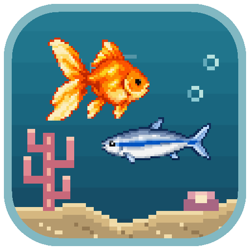
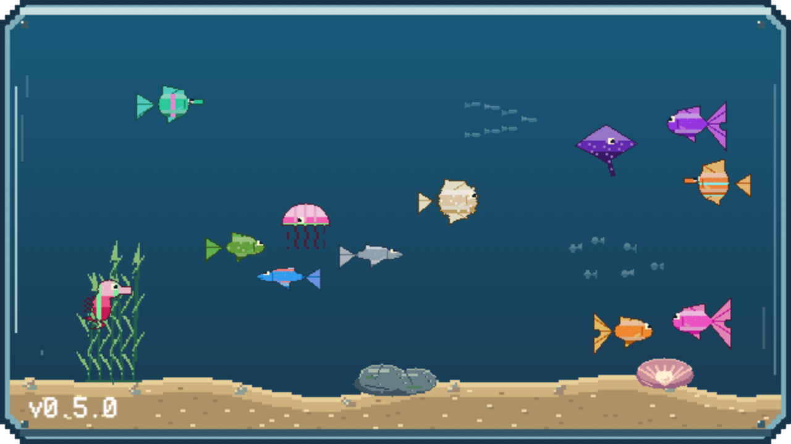
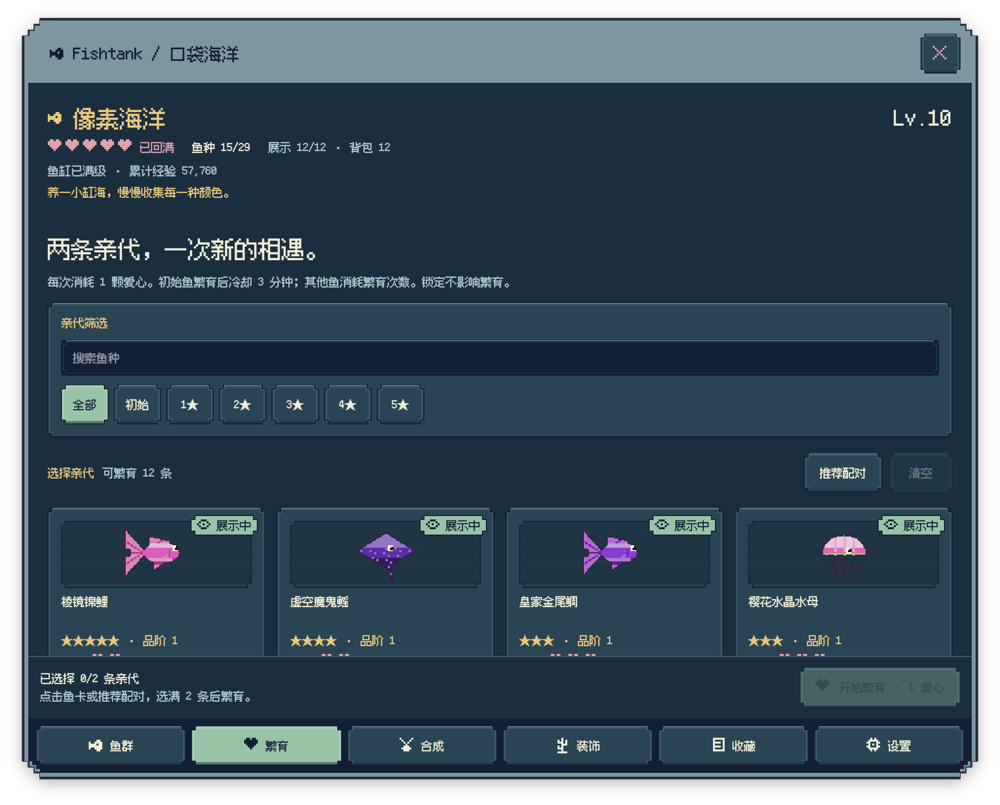
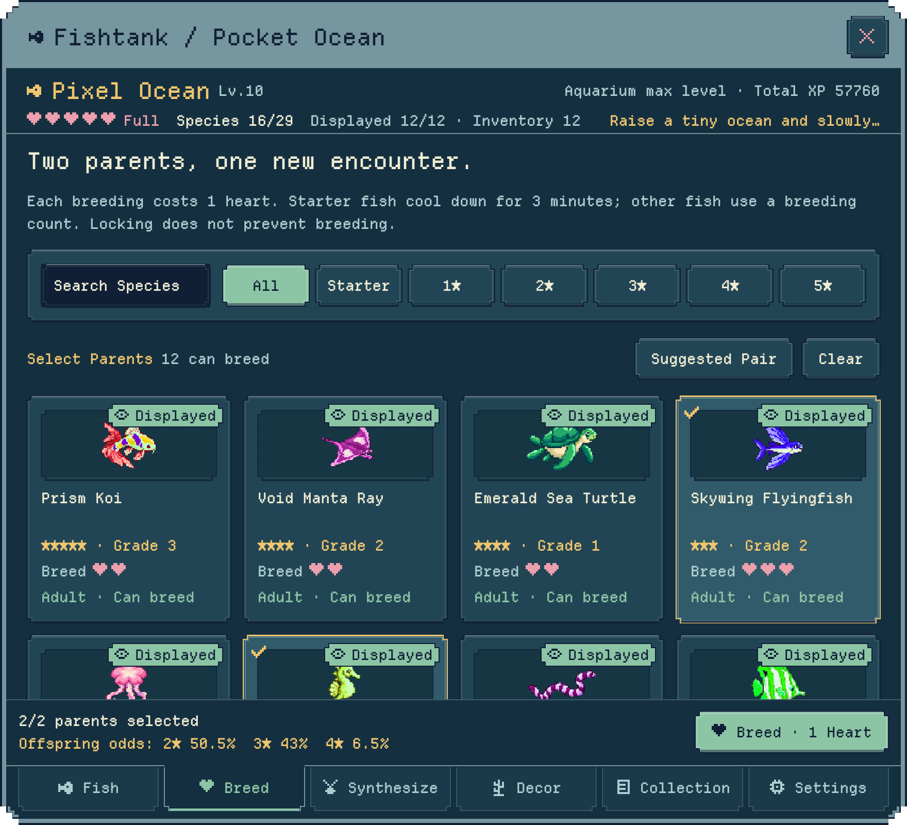
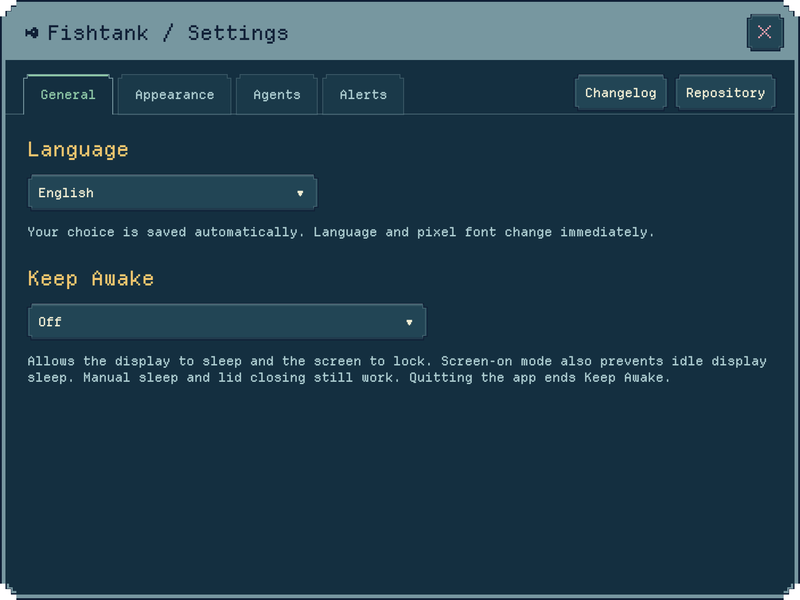
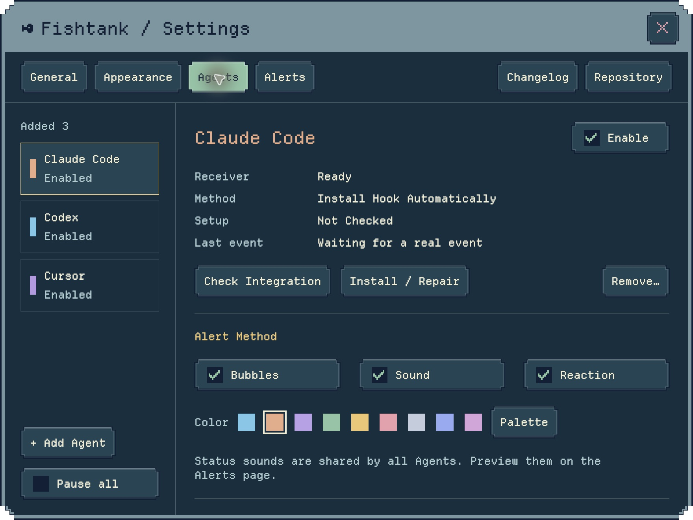
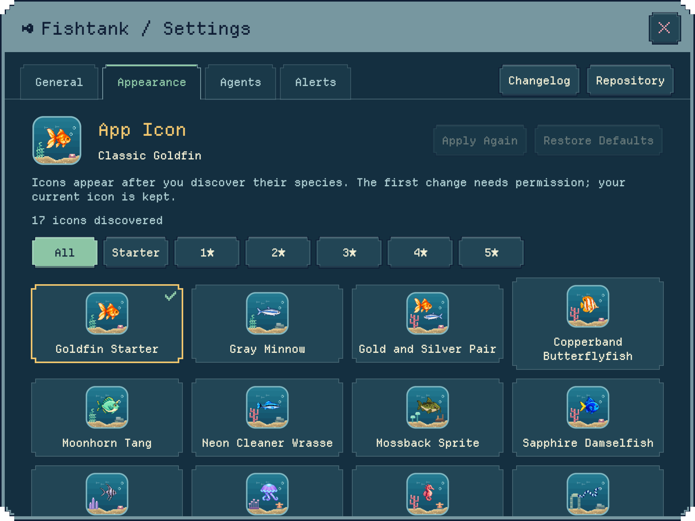

  <a href="README.md">English</a> · <a href="README.zh-Hans.md">简体中文</a> · <a href="README.zh-Hant.md">繁體中文</a> · <a href="README.ja.md">日本語</a>

  
  <h1>Fishtank</h1>
  
Keep a little ocean on your desktop, and wait for a new fish—or a little good news.

  
Pixel aquarium · Breeding and collecting · Agent notifications

  

    
    
    
  

Fishtank is a pixel aquarium for **Mac and iPad**. On Mac, it lives quietly in a corner of your desktop: fish drift by, bubbles rise, and you can drop in a bite of food whenever you like—or simply let it keep you company while you work.

The source is available now, while official installation channels for Mac and iPad are still being prepared.

## Start with a few little fish, grow an ocean

Collect **29 fish species**, breeding your first tiny swimmers into rare discoveries. Every pairing can reveal a new color, a new look, or even a fish you have never seen before.

- Watch young fish grow, choose the next pairing, and add each discovery to your collection.
- Synthesize fish to advance, expand the tank, and lock the fish you want to keep.
- Earn achievement medals and display your favorites on the aquarium.
- Progress saves automatically, so even a little time away can bring a surprise when you return.

Manage your fish, breeding, synthesis, decorations, collection, and settings in the care guide. Scroll through your fish without turning pages; counts, selections, odds, and useful actions stay within reach in the bottom bar.

Not sure which fish to pair? Suggested Pair favors species you have yet to discover, then new appearances, and the bottom bar shows the selected parents’ offspring star odds before you spend a heart.

When five-star creatures have used up their breeding chances, combine three through **five-star reforging** to welcome a new companion. Three secret species appear only through reforging, with medals for your first discovery and the complete trio. Undiscovered regular creatures show only a silhouette in the catalog—their names stay a mystery.

## More than something to watch

**Click an empty spot to feed the fish**, and food drops from the matching point on your screen. **Right-click to shake the aquarium**: a soft sound plays and every fish darts away for 3–5 seconds. You can also tap a fish to see how different species respond.

Build your underwater corner with **18 decorations**, including seagrass, coral, and a treasure chest, then add day-and-night lighting and gentle music. Look closely and you may spot fish chasing food, swimming in groups, seahorses resting, or little swimmers passing through an arch.

Choose from six gentle soundtracks, including Japanese garden, Taiwan nostalgia, and moonlight jazz.

On Mac, the aquarium offers three sizes, adjustable water transparency, and an always-on-top option. Hide it anytime you need a clear desktop.

## Keep working, let the aquarium keep you company

For longer tasks on Mac, turn on **Keep Awake** in Settings or from the menu bar. Allow the display to sleep, or keep it lit too. It is off by default; turning it off or quitting Fishtank restores normal idle sleep. Manual sleep and closing the lid still work.

Choose English, Simplified Chinese, Traditional Chinese, or Japanese in Settings. Fishtank follows your system by default and uses English for unsupported languages. Switch at any time: text and pixel fonts update immediately.

## Let work updates swim into the aquarium

Connect **Claude Code or Codex**, and progress updates, permission requests, input requests, and completed replies appear as pixel bubbles above the aquarium. Several notifications can appear together, with colors for different Agents and gentle sounds for different states.

Each source can be enabled separately, recolored, and previewed, and sounds can be turned off at any time. Manual connection presets are also available for Cursor, Gemini CLI, and OpenCode.

Notifications stay on your device, and your conversation content is never uploaded. See the [Agent setup guide](docs/AGENT_SETTINGS.md) for details.

## Discover a fish, unlock an icon

Each creature has its own **pixel aquarium icon**, with matching fish and decorations inside the same tiny tank. Icons appear only after you discover their species—including the secret creatures found through five-star reforging. Your discoveries stay available even after a creature leaves your aquarium.

## Keep your little world yours

No account is required, and your progress stays on your device. You can import, export, back up, and restore your save. Mac and iPad currently keep separate progress and do not support cloud sync.

- [View the changelog](CHANGELOG.md)
- [Visit the project homepage](https://github.com/dofy/fishtank-apple)
- [Report an issue or share an idea](https://github.com/dofy/fishtank-apple/issues)
- [Read the privacy notice](docs/PRIVACY.md)
- [Development and run guide](docs/DEVELOPMENT.md)

Screenshots show a demonstration aquarium with sample progress.

## Open source licenses

Fishtank is available under the [MIT License](LICENSE). Its pixel fonts, [Fusion Pixel](Sources/Resources/Fonts/OFL.txt) and [Departure Mono](Sources/Resources/Fonts/DepartureMono-OFL.txt), are distributed under the SIL Open Font License.
