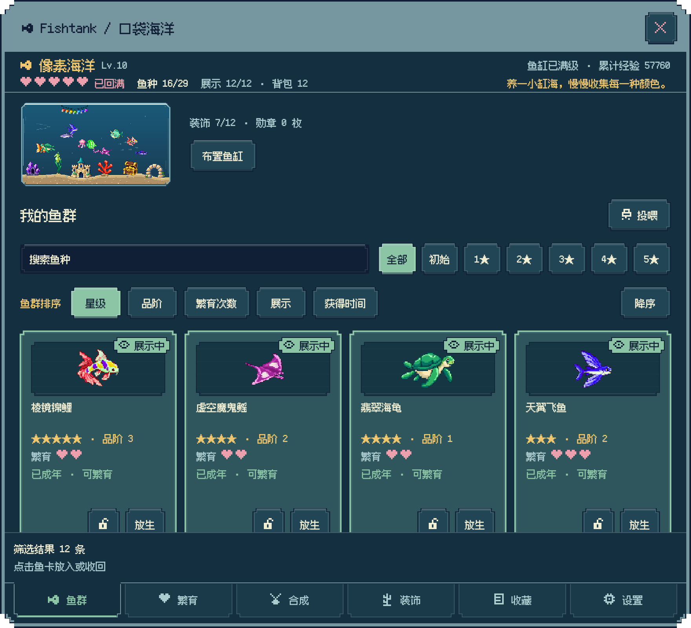
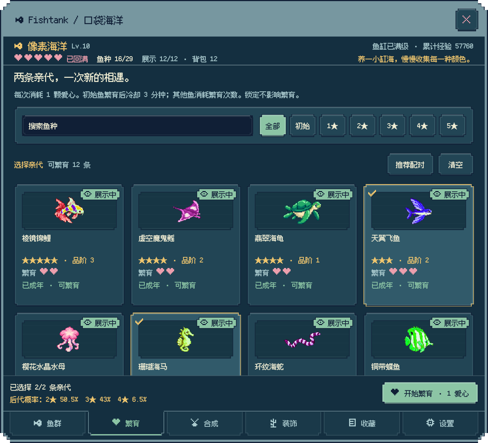
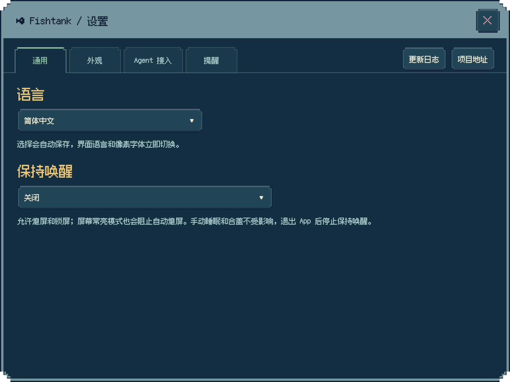
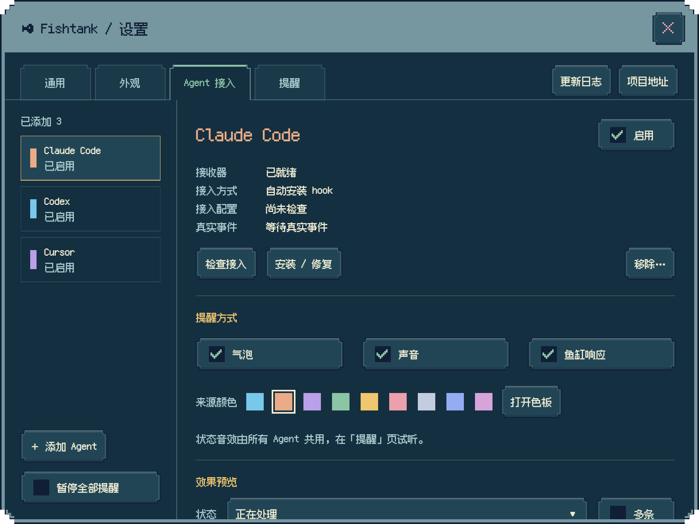
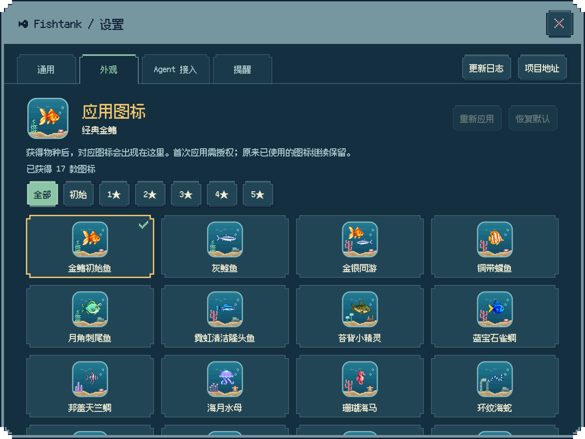

  <a href="README.md">English</a> · <a href="README.zh-Hans.md">简体中文</a> · <a href="README.zh-Hant.md">繁體中文</a> · <a href="README.ja.md">日本語</a>

  
  <h1>Fishtank</h1>
  
在桌面养一小缸海，等一条新鱼，也等一条好消息。

  
像素鱼缸 · 繁育收集 · Agent 提醒

  

    
    
    
  

Fishtank 是一款面向 **Mac 和 iPad** 的像素养鱼应用。在 Mac 上，它是一只住在桌面角落的小鱼缸：鱼儿慢慢游，气泡轻轻冒，你可以随手投一粒食物，也可以让它陪你安静工作。

项目已开放源码，Mac 与 iPad 的正式安装渠道仍在准备中。

## 从几条小鱼，养出一片海

收集 **29 种鱼**，从初始小鱼一路繁育到稀有品种。每次配对都可能遇见新的颜色、新的外观，甚至一条还没见过的鱼。

- 看幼鱼长大，选择下一次配对，把新发现收入图鉴。
- 合成进阶、扩充鱼缸，也能锁定想留下的鱼。
- 收集成就勋章，把喜欢的成果挂在鱼缸上。
- 进度自动保存，离开一会儿再回来，成长依然有惊喜。

在养成手册里管理鱼群、繁育、合成、装饰、收藏和设置。鱼群列表可以连续滚动，不用来回翻页；数量、选择、概率和常用操作集中在底栏，浏览时随时看得见、点得到。

不知道下一对选谁？「推荐配对」会优先帮你寻找未发现的鱼种，再补齐新的外观；选好后，底栏会显示当前亲代的后代星级概率，再决定是否消耗爱心。

五星生物用尽繁育次数后，还能用三条进行**五星重铸**，迎接一位新伙伴。三种只在重铸中出现的隐藏生物，等你发现；首次相遇和全部集齐都有专属勋章。未发现的普通生物在图鉴里只露出剪影，名字暂时保密。

## 不只是看着它游

**单击空白处投喂**，食物会从鼠标对应的位置落下。**右键晃动鱼缸**，听一声轻响，看所有鱼受惊快游 3～5 秒。也可以轻点鱼儿，观察不同品种的小反应。

用海草、珊瑚、宝箱等 **18 件装饰**布置自己的水下角落，配上昼夜灯光和轻音乐。细看还能发现追食、结群、海马休息、穿拱门等小彩蛋。

六种轻柔配乐随心切换，包括日系庭院、台式怀旧和月光 Jazz。

Mac 鱼缸支持三种大小、水体透明度和置顶开关；需要专心时，随时隐藏它。

## 工作久一点，也有小鱼陪着

在 Mac 上运行长任务时，可以从设置或菜单栏开启**保持唤醒**，选择允许屏幕熄灭，或让屏幕一起常亮。默认关闭，关闭或退出 Fishtank 后恢复正常的自动睡眠，手动睡眠和合盖仍然有效。

设置支持简体中文、繁体中文、英语和日语，默认跟随系统，无法匹配时使用英语。随时切换语言，界面文字和像素字体立即一起更新。

## 让工作消息，也游进鱼缸

接入 **Claude Code 或 Codex** 后，处理进度、待授权、待输入和回复结束会变成鱼缸上方的像素气泡。多条提醒可以同时出现，不同 Agent 用不同颜色辨认，不同状态配上轻音效。

每个来源都能单独开关、调色和预览；声音也可以随时关闭。Cursor、Gemini CLI 和 OpenCode 提供手动接入预设。

提醒只在本机接收，不上传你的对话内容。具体设置见 [Agent 接入指南](docs/AGENT_SETTINGS.md)。

## 发现一条鱼，也解锁一个图标

每种生物都有自己的**像素鱼缸图标**，让不同生物和装饰住进同一只小鱼缸。对应物种首次发现后，图标才会出现并可选；五星重铸发现的隐藏生物也有专属图标。生物离开鱼缸后，已发现的图标依然保留。

## 保留自己的小世界

无需注册账号，养成进度保存在本机。支持导入、导出、自动备份与恢复，Mac 和 iPad 目前各自保存进度，暂不支持云同步。

- [查看更新日志](CHANGELOG.md)
- [前往项目主页](https://github.com/dofy/fishtank-apple)
- [反馈问题或提出想法](https://github.com/dofy/fishtank-apple/issues)
- [了解隐私说明](docs/PRIVACY.md)
- [开发与运行指南](docs/DEVELOPMENT.md)

截图使用演示鱼缸与示例进度。

## 开源许可

项目采用 [MIT License](LICENSE)。像素字体 [Fusion Pixel](Sources/Resources/Fonts/OFL.txt) 与 [Departure Mono](Sources/Resources/Fonts/DepartureMono-OFL.txt) 分别遵循 SIL Open Font License。
