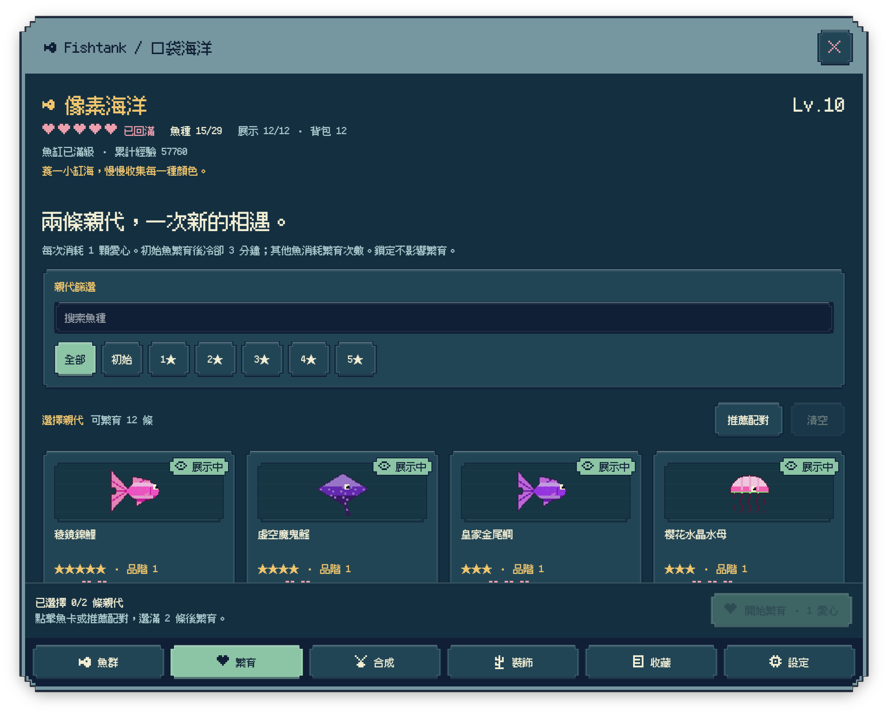
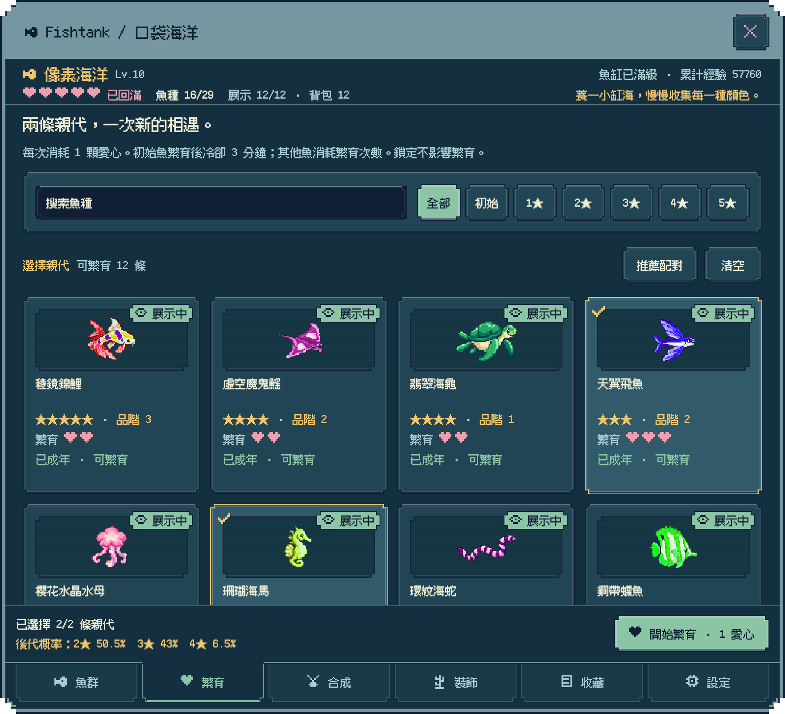
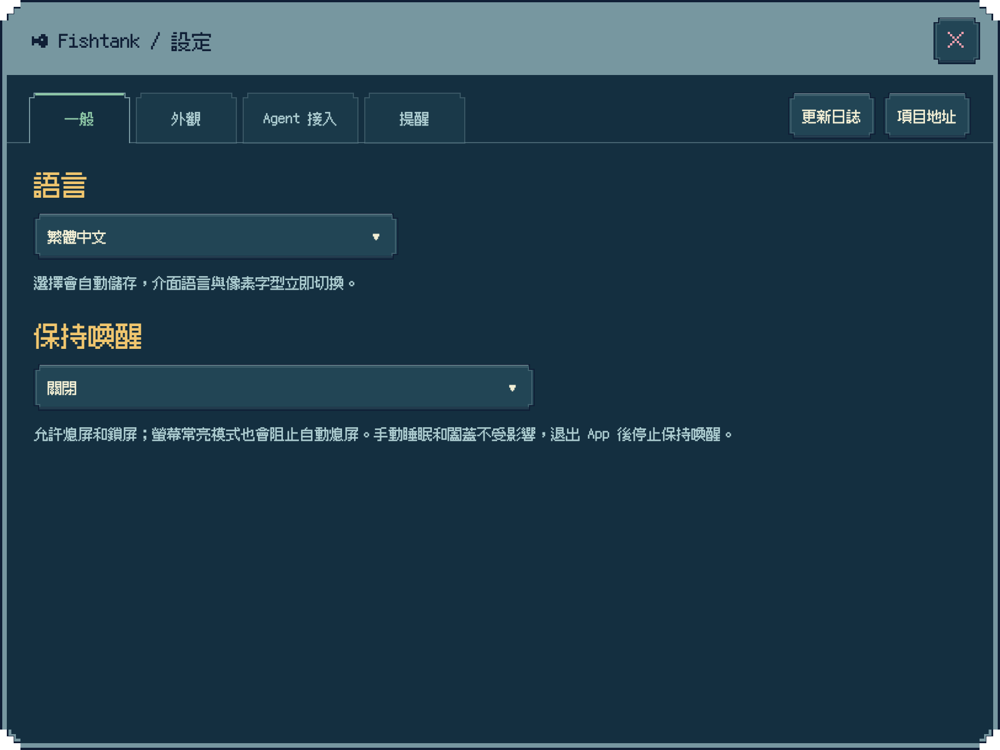
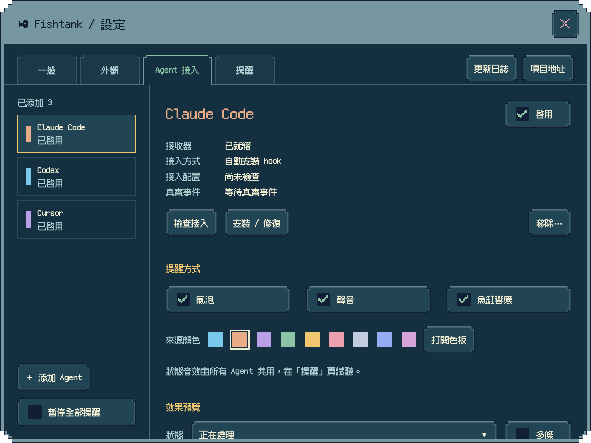
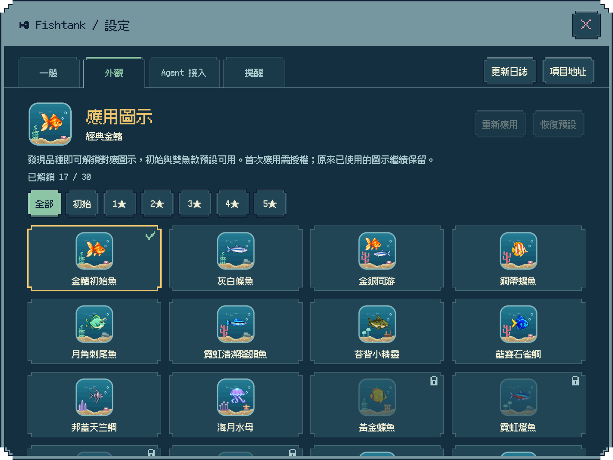

  <a href="README.md">English</a> · <a href="README.zh-Hans.md">简体中文</a> · <a href="README.zh-Hant.md">繁體中文</a> · <a href="README.ja.md">日本語</a>

  
  <h1>Fishtank</h1>
  
在桌面養一小缸海，等一條新魚，也等一則好消息。

  
像素魚缸 · 繁育收藏 · Agent 通知

  

    
    
    
  

Fishtank 是一款為 **Mac 和 iPad** 打造的像素養魚應用程式。在 Mac 上，它是一座住在桌面角落的小魚缸：魚兒悠閒游動，氣泡輕輕升起，你可以隨手投一粒飼料，也可以讓它安靜陪你工作。

專案已開放原始碼，Mac 與 iPad 的正式安裝管道仍在準備中。

## 從幾條小魚，養出一片海

收藏 **30 種一般生物**，從最初的小魚一路繁育出五星錦鯉、水母、海龍與烏賊。每次配對都可能遇見新的色彩、新的外觀，甚至一位從未見過的水下夥伴。

- 看著幼魚長大，選擇下一次配對，把新發現收進圖鑑；清楚的狀態標示幫你分辨成長中、冷卻中與可以繁育的魚。
- 合成進階、擴充魚缸，也能鎖定想留下的魚。
- 收集成就勳章，把喜歡的成果掛在魚缸上。
- 進度會自動儲存，離開一會兒再回來，成長依然可能帶來驚喜。

在養成手冊裡管理魚群、繁育、合成、裝飾、收藏和設定。魚群清單可以連續捲動，不必來回翻頁；數量、選擇、機率與常用操作集中在底欄，瀏覽時隨時看得到、點得到。

不知道下一對該選誰？「推薦配對」會優先尋找尚未發現的魚種，再補齊新的外觀；選好後，底欄會顯示目前親代的後代星級機率，再決定是否消耗愛心。

五星生物用盡繁育次數後，還能用三條進行**五星重鑄**，迎接一位新夥伴。三種只在重鑄中出現的隱藏生物，等你發現；首次相遇和全部集齊都有專屬勳章。未發現的普通生物在圖鑑裡只露出剪影，名字暫時保密。

## 不只是看著牠游

**點一下空白處餵食**，飼料會從游標對應的位置落下。**雙擊打開養成手冊**，**按右鍵搖晃魚缸**，伴隨一聲輕響，所有魚會受驚快游 3～5 秒。你也可以輕點魚兒，看看不同品種的小反應。

每種生物都有自己的游動節奏：魚兒偶爾休息或結伴，海龜划動鰭肢，水母一收一放地前行，烏賊會前游、倒游，也會停下來懸浮。轉身、起步與停下，都有柔和的過渡。

用海草、珊瑚、寶箱等 **18 件裝飾**布置自己的水下角落，再配上日夜燈光和輕柔音樂。仔細看，還能發現追逐飼料、海馬在海草旁停留、小魚穿過拱門等日常片段。

六種輕柔配樂隨心切換，包括日系庭院、臺式懷舊與月光 Jazz。

Mac 魚缸提供三種大小、水體透明度和置頂開關；需要專心時，隨時都能將它隱藏。

## 工作久一點，也有小魚陪著

在 Mac 上執行長任務時，可以從設定或選單列開啟**保持喚醒**，選擇允許螢幕熄滅，或讓螢幕一起常亮。預設關閉，關閉或結束 Fishtank 後會恢復正常的自動睡眠，手動睡眠和闔蓋仍然有效。

設定支援簡體中文、繁體中文、英文和日文，預設跟隨系統，無法匹配時使用英文。隨時切換語言，介面文字與像素字型立即一同更新。

## 讓工作訊息也游進魚缸

連接 **Claude Code 或 Codex** 後，處理進度、等待授權、等待輸入和回覆完成都會化成魚缸上方的像素氣泡。多則通知可以同時出現，不同 Agent 以不同色彩辨認，各種狀態也有輕柔音效。

每個來源都能獨立開關、調整顏色和預覽；聲音也能隨時關閉。Cursor、Gemini CLI 和 OpenCode 另有手動連接預設。

通知只在本機接收，不會上傳你的對話內容。詳細設定請參閱 [Agent 連接指南](docs/AGENT_SETTINGS.md)。

## 發現一條魚，也解鎖一款圖示

每種生物都有自己的**像素魚缸圖示**，讓不同生物與裝飾住進同一座小魚缸。首次發現對應物種後，圖示才會出現並可選；五星重鑄發現的隱藏生物也有專屬圖示。生物離開魚缸後，已發現的圖示依然保留。

## 留住自己的小世界

無需註冊帳號，養成進度保存在本機。支援匯入、匯出、自動備份與還原；Mac 和 iPad 目前分別保存進度，暫不支援雲端同步。

- [查看更新日誌](CHANGELOG.md)
- [前往專案首頁](https://github.com/dofy/fishtank-apple)
- [回報問題或提出想法](https://github.com/dofy/fishtank-apple/issues)
- [閱讀隱私說明](docs/PRIVACY.md)
- [開發與執行指南](docs/DEVELOPMENT.md)

螢幕截圖使用示範魚缸與範例進度。

## 開放原始碼授權

本專案採用 [MIT License](LICENSE)。像素字型 [Fusion Pixel](Sources/Resources/Fonts/OFL.txt) 與 [Departure Mono](Sources/Resources/Fonts/DepartureMono-OFL.txt) 分別遵循 SIL Open Font License。
