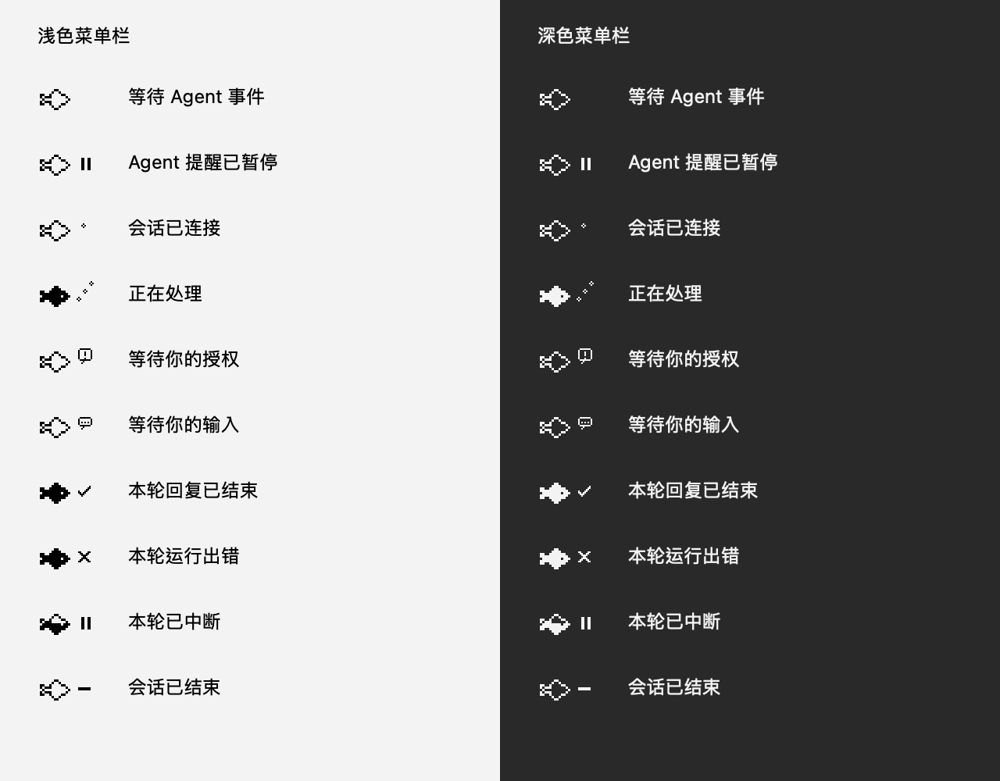

# Agent 设置（macOS）

从菜单「设置…」或养成手册「设置 → 应用设置」打开独立窗口。应用处于前台时也可按 ⌘,。设置窗口固定为 880 × 660，可移动和关闭，不支持调整尺寸或全屏。菜单仅保留设置入口、暂停全部提醒和声音开关；鱼缸常用操作继续保留。

## 已有接入

首次打开沿用 Claude Code、Codex 原有的提醒开关和声音偏好。迁移只建立本地展示，**不读取或重写外部 hook 文件，不修改 Codex 信任记录**。每个来源可分别启用、控制气泡/声音/水面反馈、选择来源颜色。暂停只停止提醒，接入配置保留；真实事件仍可更新状态页。

来源颜色备选包含全部预设的默认色及当前已保存的颜色。末尾「打开色板」调出 macOS 色板，选择后立即保存 RGB 颜色；切换来源、设置页面或关闭设置窗口会关闭色板，避免误改其他来源。颜色调整不写入外部 hook 或信任记录。

## 添加与移除

「添加 Agent」提供 Claude Code、Codex、Cursor、Gemini CLI、OpenCode 预设，也保留自定义来源。预设自动填入名称与来源颜色；已有来源点击「查看」，不重复创建。只有 Claude Code、Codex 支持自动安装。Cursor、Gemini CLI 需手动配置 hook，OpenCode 需手动配置事件插件；详情页提供官方文档与发送命令。原始事件与数据格式需转换为鱼缸标准 JSON，添加预设本身不代表接通。预设来源使用稳定 ID，移除后重新添加会恢复接收该 ID 的已有发送命令。内置来源添加后，在详情点击「安装 / 修复」。首次读写外部配置时，macOS 文件选择器请求对应 `.claude` 或 `.codex` 文件夹，之后使用应用范围安全书签保留访问权限；自定义配置位置可选择包含原配置文件的目录。

安装只添加缺失事件，已有鱼缸命令及行内设置保持不变；重试幂等。修改前在所选目录备份原文件，备份权限为 0600。配置格式无法安全处理时停止；不会覆盖格式错误的文件或猜测其他 handler 的归属。已有文件权限保留，新文件使用 0600。

移除内置来源需确认，会卸载鱼缸拥有的 handler 并移除本地来源，保留同一行的其他 handler、其他配置字段及信任记录。取消目录授权或处理失败时不移除本地来源。移除自定义来源会停止接收该来源；外部 Agent 中粘贴过的命令需自行删除。重新添加自定义来源会生成新的 ID，旧命令不会自动恢复接收。

新安装的 Codex handler 仍需在 Codex `/hooks` 审阅信任。应用不自动写入、清理或迁移信任记录。

## 检查与预览

- **检查接入**：内置来源先检查配置中预期的鱼缸 handler 是否齐全，再发送带独立标识的原生本机测试事件。自定义来源检查本机接收通路。成功只证明配置检测和接收器通路正常，不证明外部 Agent 的实际 hook 已执行。
- **真实事件**：单独显示当前进程收到的最近实际事件和时间。没有事件时显示「等待真实事件」，不能据此断言 Agent 离线。没有心跳，不从静默猜测完成或断线。
- **效果预览**：选择状态、单条/多条及是否播放声音，在鱼缸上展示。多条模式显示三条，来源不足时重复选中来源。预览可以在来源暂停时使用；不会调用模型或污染真实会话状态。鱼缸隐藏时，明确点击预览会显示鱼缸。

## 自定义来源

添加名称后会生成独立 ID，详情中的「复制发送命令」提供应用内置发送器的完整命令，不含接入 token。在外部 Agent 的 hook 中执行此命令，并通过标准输入提供：

```json
{"hook_event_name":"Stop","session_id":"your-session-id","cwd":"/your/project"}
```

标准事件为 `SessionStart`、`UserPromptSubmit`、`PermissionRequest`、`NeedsInput`、`Stop`、`StopFailure`、`Interrupt`、`SessionEnd`。外部 Agent 的原始名称和数据格式需要由其 hook 映射；并非添加名称后就完成集成。最多保存 16 个来源。删除来源后接收器忽略其后续事件。

发送器只提取事件元数据，不发送 prompt、完整目录、回复或工具内容。名称和颜色由本地注册表提供，发送者不能覆盖气泡中的来源显示。发送器使用现有 Python 3；设置窗口内的接收器检查使用原生 Network 接口，不依赖 Python 子进程。

## 提醒页

统一管理 Agent 声音总开关、轻音量（0–50%）、8 种状态的提醒开关和试听，以及养成系统通知。所有来源共用状态音效；颜色区分来源。游戏音乐/音效继续保留在养成手册，不受影响。关闭声音立即停止当前和排队提示，重新开启不补播；暂停来源、移除来源或关闭对应状态也会清理相关提示。试听和明确点击的预览不受状态筛选影响，声音总开关仍有效。

## 验证

核心检查包括安全定向合并/卸载、旧配置字节级幂等、命令保留、异常格式、自定义来源编码、注册表验证和声音队列。`tools/verify-agent-settings.swift` 需要独立 QA bundle ID 和临时存档，覆盖偏好迁移、增删持久化、合成配置的安装/修复/卸载、真实回环收件、暂停/状态筛选、预览、菜单入口及固定尺寸布局；另用实际沙盒权限和本机开发签名复核相同操作。所有读写验收使用合成配置，未在个人配置上执行安装或卸载。


## 状态栏小鱼

菜单栏图标固定为 36 × 18 pt，使用单色模板适配浅色和深色菜单栏。等待事件为空心鱼；会话连接为空心鱼加小气泡；处理中为实心鱼加上升气泡；待授权与待输入为空心鱼加不同提示气泡；本轮回复结束为实心鱼加勾；出错为实心鱼加叉；中断为半实心鱼加暂停；会话结束为空心鱼加横线；暂停全部提醒为空心鱼加暂停。

多个会话时依次优先：出错、待授权、待输入、处理中、中断、回复结束、连接、结束。同优先级选最近更新的会话，悬停查看当前来源、项目、状态。只汇总已添加且启用的来源，并尊重状态提醒筛选；每个来源的气泡或声音单独关闭不影响状态栏摘要。移除来源会清理对应会话，重新添加不会显示旧状态。

处理中、待授权与待输入在 15 分钟无新事件后不再用于状态栏；出错保留 2 分钟，其余短暂状态保留 30 秒。恢复普通图标只表示没有可展示的近期状态，**不表示 Agent 已完成或断线**。利用现有时钟刷新，无持续闪烁或动画定时器。

详情页「在鱼缸预览」会同时预览状态栏图标，8 秒后恢复真实状态；预览期间如收到真实事件，立即结束图标预览。多条预览展示所选来源与所选状态，其他演示气泡不覆盖它。设置变化也会退出预览。



`Tests/AgentMenuIndicatorTests.swift` 检查优先级、时效、同会话转移、暂停、筛选、移除、预览隔离与来源名称。`tools/verify-menu-status-icons.swift` 在独立 QA 身份和临时存档下验证 10 张不同的等宽模板、真实 NSStatusItem 更新、提示文字、8 秒预览恢复、原生回环事件与移除后无旧状态恢复。

## 保持唤醒（Mac 通用设置）

设置 → 通用 → 保持唤醒，与菜单栏的同名子菜单共用状态。默认关闭，选择会保存在本机；下次打开应用恢复所选模式。提供关闭、保持电脑运行、同时保持屏幕常亮三项，沿用像素选择控件与四语文案。

保持电脑运行允许熄屏和锁屏，只阻止因闲置自动睡眠；屏幕常亮模式同时阻止自动熄屏。不会主动点亮已经熄灭的屏幕，也不改变手动睡眠、合盖及低电量等系统策略。退出应用后释放系统断言，隐藏鱼缸则继续保持所选模式。系统拒绝切换时保留原模式并显示错误，不把失败的模式写入偏好。此设置不写入玩家存档，不改 Agent 配置或信任记录。
