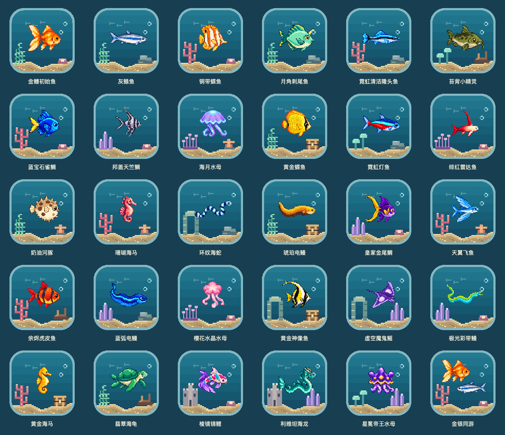

# macOS 应用图标

从菜单「设置… → 外观」打开。共 30 款：29 个品种各一款，另加「金银同游」双鱼特别款。所有图标使用相同的 64 像素水体、沙床、等宽玻璃边框，只替换鱼种与装饰。金鳍初始鱼沿用默认图标，其余 29 款可切换。之前 12 款的 ID 与设计保持不变，已有选择无需迁移。

设置窗口固定为 880 × 660，全部图标在同一列表中滚动展示，不分页、不搜索。使用与繁育页一致的「全部、初始、1★–5★」按钮筛选，按星级从低到高排列。卡片显示实际品种名称，顶部显示主题名；筛选不会自动应用图标。

点击卡片预览，点击「使用此图标」应用到访达和运行时程序坞。已使用的图标仍可「重新应用」，方便系统缓存或应用更新后重新同步。此选择不影响菜单栏的状态小鱼，系统通知图标由 macOS 管理。

首次应用时通过系统选择器选择**正在运行的 Fishtank.app**，授予自定义图标访问；取消不保存选择，选错应用不进行修改。成功后保存安全书签和图标 ID，后续复用；授权失效时重新选择。只有应用成功才持久化图标 ID。重启会恢复运行时图标；更新应用后如果访达恢复默认，可重新应用。此设置不影响鱼群、装饰存档、音效与 Agent 接入。

| 图标 | 鱼种 | 装饰组合 |
| --- | --- | --- |
| 珊瑚蝶影 | 铜带蝶鱼 | 珊瑚、珍珠贝 |
| 月角青礁 | 月角刺尾鱼 | 海草、礁石 |
| 蓝宝石湾 | 蓝宝石雀鲷 | 珊瑚、珍珠贝 |
| 金蝶宝藏 | 黄金蝶鱼 | 海草、宝箱 |
| 霓虹海蕈 | 霓虹灯鱼 | 海蕈、礁石 |
| 奶油海星 | 奶油河豚 | 海草、海星 |
| 绯色海马 | 珊瑚海马 | 珊瑚、海星 |
| 紫晶金尾 | 皇家金尾鲷 | 紫晶、珍珠贝 |
| 樱花水母 | 樱花水晶水母 | 海葵、珍珠贝 |
| 深海鳐影 | 虚空魔鬼鳐 | 石拱、紫晶 |
| 翡翠沉木 | 翡翠海龟 | 海草、沉木 |
| 锦鲤城堡 | 棱镜锦鲤 | 城堡、珍珠贝 |



## 素材和生成

设计目录：`Sources/Core/AppIconCatalog.swift`；像素绘制：`Sources/Rendering/AppIconArt.swift`。使用项目原有 `PixelArt` 鱼类素材，无外部生成模型或第三方素材。

```sh
xcrun swiftc -parse-as-library Sources/Core/*.swift Sources/Rendering/PixelArt.swift Sources/Rendering/PaintedSprites.swift Sources/Rendering/AppIconArt.swift tools/generate-icon-variants.swift -o /tmp/fishtank-icon-generator
FISHTANK_ART_ROOT=Sources/Resources/PixelSprites /tmp/fishtank-icon-generator
```

输出在 `Sources/Resources/AppIcons/`，每款包含 512px PNG 预览与完整 16–1024px ICNS。Mac 打包资源共 29 对，另含默认 ICNS 与品种清单 AppIconCatalog.json，iPad 默认图标不变。`tools/check-release-bundle.py` 检查数量、格式、尺寸、设计不重复及原有发布要求。

## 系统行为

使用 Apple [NSApplication.applicationIconImage](https://developer.apple.com/documentation/appkit/nsapplication/applicationiconimage) 恢复运行时图标，使用 [NSWorkspace.setIcon](https://developer.apple.com/documentation/appkit/nsworkspace/seticon(_:forfile:options:)) 设置访达自定义图标；不替换包内 `Contents` 中的签名资源。系统可能在应用包外层增加 `Icon\r` 文件和 FinderInfo；正常 `codesign --verify --deep` 继续通过，`--strict` 会拒绝这类系统自定义元数据。发布包保持无自定义元数据，并在安装前进行严格签名验证。


## 验证

`swift test` 覆盖图标目录唯一性、引用的鱼与装饰存在，以及未知保存 ID 的默认回退。将 `tools/verify-app-icons.swift` 与 AppIconCatalog、AppIconStore 编译到包含图标资源的独立 `net.yahaha.fishtank.renderqa.*` QA 应用，可验证全部非默认图标的实际应用、偏好持久化、运行时恢复、恢复默认及 Contents 资源哈希不变。此工具拒绝在正式应用身份下运行。

本地沙盒 QA 另验证取消系统选择器不改变偏好、选择当前 QA 应用后可写访达图标、安全书签复用和恢复默认。实际窗口通过原生点击检查卡片边缘、预览与应用、已使用标记、页面重开和固定尺寸布局。个人安装只替换经过签名验证的新包，不自动选择新图标。


## 按品种发现解锁

使用当前存档的永久图鉴 `discovered` 判断可用性，不依赖玩家等级、当前背包或鱼缸里是否还保留该鱼。繁育或合成发现新物种后，对应图标立即可用；放生不会撤销发现。初始两种和「金银同游」默认可用，所以新存档初始开放 3 / 30 款。

未发现的品种仍可浏览和预览，卡片显示锁，应用按钮禁用；应用模型也会在写入图标和偏好前检查解锁条件。已有安装上原来正在用的图标不会被自动替换，但重新应用或选择其他图标需要满足当前图鉴条件。没有新增解锁存档字段，也不会修改用户的品种发现记录。

选择区使用繁育页同款星级按钮筛选，全部图标连续滚动，按星级升序排列，顶部显示已解锁总数。筛选、预览均不会自动切换应用图标。全套总览使用 `tools/generate-icon-overview.swift` 生成。
